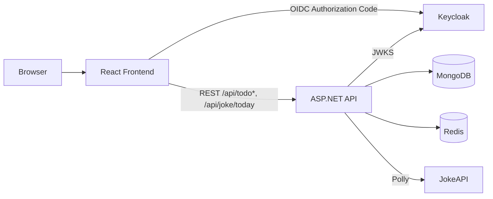

# React API Template

A modern full-stack template combining a React SPA, a .NET Web API, MongoDB persistence, a Redis-backed cache, and OIDC authentication.

This repository is designed to bootstrap a production-minded app quickly, with a strong local developer experience through .NET Aspire orchestration.

## Highlights

- React 19 + Vite+ + TypeScript frontend (Oxlint / Oxfmt through `vp`)
- Server state with TanStack Query, client state with Zustand, light/dark mode with MUI 9 color schemes
- .NET 11 Minimal APIs, OpenAPI document (`Microsoft.AspNetCore.OpenApi`) browsable with Scalar
- Expected failures returned as `Elyspio.Utils.Results` values and mapped to ProblemDetails; unexpected ones stay exceptions
- MongoDB data layer, FusionCache (memory + Redis L2 + backplane), Polly resilience on outgoing HTTP calls
- OIDC login (Keycloak) and JWT validation on the API
- OpenTelemetry (traces, metrics, logs over OTLP) through `Elyspio.Utils.Telemetry`, configured by the standard `OTEL_*` variables
- Typed TypeScript SDK and TanStack Query options generated from the OpenAPI document (`@hey-api/openapi-ts`)
- Integration tests on real MongoDB and Redis containers

## Stack

| Layer | Tech |
|---|---|
| Frontend | React, Vite+ (Vite, Oxlint, Oxfmt), TypeScript, TanStack Query, Zustand, MUI, react-oidc-context |
| Backend | ASP.NET Core (.NET 11) Minimal APIs, System.Text.Json, OpenAPI + Scalar, Serilog |
| Data | MongoDB (Aspire.MongoDB.Driver), Redis (FusionCache L2 + backplane) |
| Auth | OIDC (Keycloak realm provided for local dev), JWT bearer on the API |
| Resilience | Microsoft.Extensions.Http.Resilience (Polly 8 pipelines) |
| Tests | xUnit v3 (Microsoft.Testing.Platform), Shouldly, Testcontainers |
| Orchestration | Aspire 17 AppHost |
| Build/Deploy | Docker Buildx + Docker Compose |

## Monorepo Structure

```text
.
|- Example.Front/          # React application
|  |- src/
|  |- public/conf.js       # Runtime frontend config (API + OIDC)
|  `- scripts/refresh-api.ts
|
|- Example.Api/
|  |- Example.Api.Web/                 # ASP.NET Core API
|  |- Example.Api.Core/                # Business services
|  |- Example.Api.Adapters.Mongo/      # Mongo repositories
|  |- Example.Api.Adapters.Rest/       # Outgoing HTTP (JokeAPI client + Polly pipeline)
|  |- Example.Api.Abstractions/        # Contracts/models/errors
|  `- Example.Api.Tests/               # Integration tests (WebApplicationFactory + Testcontainers)
|
|- Example.AppHost/        # Aspire orchestrator (frontend + api + mongo + redis + keycloak)
|
`- Deployment/             # Deployment assets (docker compose + runtime config)
```

## Architecture



## Quick Start (Recommended)

Run the full local stack with Aspire (frontend + api + mongodb + redis + keycloak):

```bash
aspire run 
```

What you get:

- Frontend served by Vite app resource
- API project started and wired to MongoDB, Redis and Keycloak
- Keycloak container preloaded with realm `react-api-template` (its access tokens carry the `react-api-template-api` audience)
- Aspire dashboard for local observability

Local demo credentials (from `Example.AppHost/keycloak/react-api-template-realm.json`):

- Username: `demo`
- Password: `demo`

## Manual Development (Without Aspire)

### 1. Frontend

```bash
cd Example.Front
pnpm install
pnpm dev
```

### 2. Backend

The API expects `ConnectionStrings:MongoDB`, `ConnectionStrings:Redis`, `Keycloak:Realm`, `Keycloak:Audience` and the Keycloak URL as `services:keycloak:https:0` (service discovery).

```bash
dotnet run --project Example.Api/Example.Api.Web/Example.Api.Web.csproj
```

By default, launch settings expose HTTP on port `4000`.

If you run backend manually, ensure:

- reachable MongoDB, Redis and Keycloak instances
- CORS origins are configured if frontend is on another origin (`Cors:AllowedOrigins`)

## Frontend Runtime Configuration

`Example.Front/public/conf.js` is loaded at runtime and provides fallback values:

- `window.example.config.endpoints.core`
- `window.example.config.oidc.*`

Supported Vite env overrides (`Example.Front/src/config/env.d.ts`):

- `VITE_API_BASE_URL`
- `VITE_OIDC_AUTHORITY`
- `VITE_OIDC_REALM`
- `VITE_OIDC_CLIENT_ID`
- `VITE_OIDC_SCOPE`
- `VITE_OIDC_REDIRECT_PATH`
- `VITE_OIDC_POST_LOGOUT_REDIRECT_PATH`
- `VITE_OIDC_SILENT_REDIRECT_PATH`

## API Endpoints

Endpoints are Minimal APIs in `Example.Api/Example.Api.Web/Endpoints/`:

- `GET /api/todo`, `POST /api/todo`, `PUT /api/todo/{id}/toggle`, `DELETE /api/todo/{id}`: public board (anonymous)
- `GET /api/todo/user`, `POST /api/todo/user`, `PUT /api/todo/user/{id}/toggle`, `DELETE /api/todo/user/{id}`: board of the connected user (bearer token required)
- `GET /api/joke/today`: joke of the day from JokeAPI, cached until midnight (UTC) with fail-safe

Failures are ProblemDetails: `400` (invalid label, with field errors), `401`, `404`, `502` (joke provider down). The OpenAPI document is served at `/openapi/v1.json`, its UI at `/scalar`.

## Generate/Refresh Frontend API Client

With the API running:

```bash
cd Example.Front
pnpm refresh-api                                        # https://localhost:4000/openapi/v1.json (AppHost)
pnpm refresh-api http://localhost:4000/openapi/v1.json  # or any URL (also OPENAPI_URL)
```

The SDK (fetch client, types, TanStack Query `queryOptions` / `mutationOptions`) is generated by `@hey-api/openapi-ts` into `src/core/apis/backend/generated`. `src/core/apis/backend/index.ts` sets its base URL and adds the access token.

## Tests

```bash
dotnet test --project Example.Api/Example.Api.Tests/Example.Api.Tests.csproj
```

Requires Docker (MongoDB and Redis containers). Keycloak and JokeAPI are replaced by fakes.

## Frontend Scripts

From `Example.Front/`:

- `pnpm dev` - start the Vite dev server
- `pnpm build` - production build
- `pnpm preview` - serve the production build
- `pnpm check` - format check + lint + type check (`vp check`, `vp check --fix` to fix)
- `pnpm lint` - lint only (Oxlint, type-aware)
- `pnpm fmt` - format files (Oxfmt)
- `pnpm refresh-api` - regenerate OpenAPI client

## Deployment

Deployment example (Traefik-oriented) is under:

- `Deployment/environments/prod/docker-compose.yml`

Runtime overrides are mounted from:

- `Deployment/environments/prod/config/front/conf.js`
- `Deployment/environments/prod/config/back/appsettings.docker.json`

## Requirements

- .NET SDK 11.0.100+ (pinned by `global.json`, projects target `net11.0`)
- Aspire CLI 17 for `aspire run` (DCP and the dashboard ship with the CLI)
- Node.js 26+ and pnpm 12 (exact version pinned by `packageManager` in `Example.Front/package.json`)
- Docker (Aspire resources, integration tests, production images)

## Notes

- The entire app is protected by OIDC flow in the frontend router.
- Theme can be switched from the UI (light/dark, persisted by MUI) or forced with `?theme=light|dark`.
- The repository is intended as a template: adjust naming, security defaults, and deployment specifics before production use.
